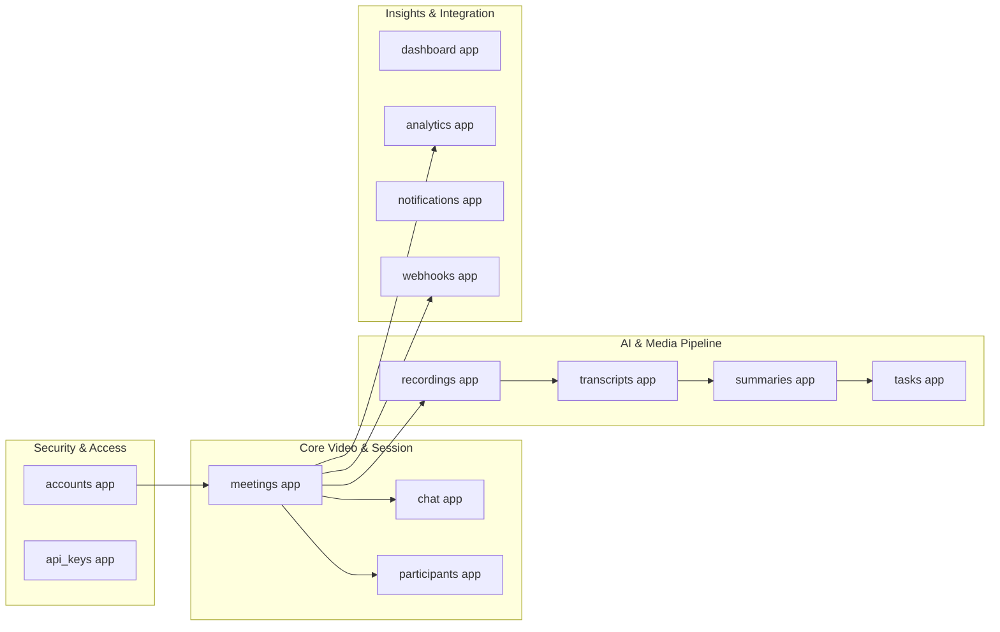
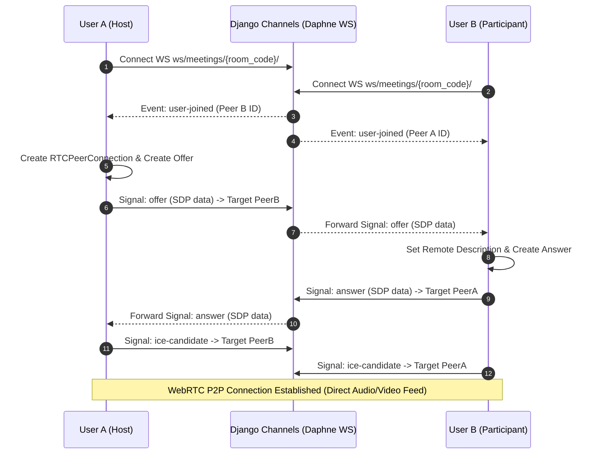
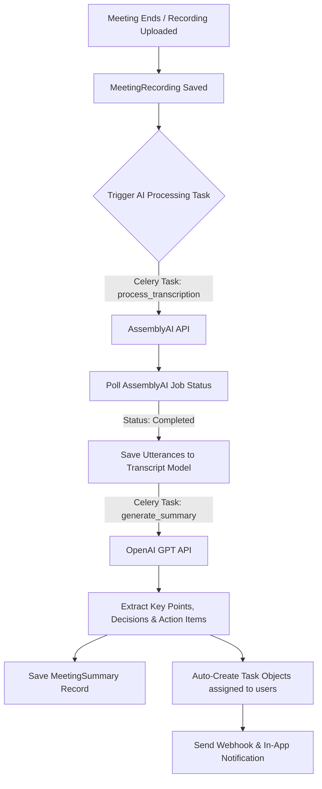
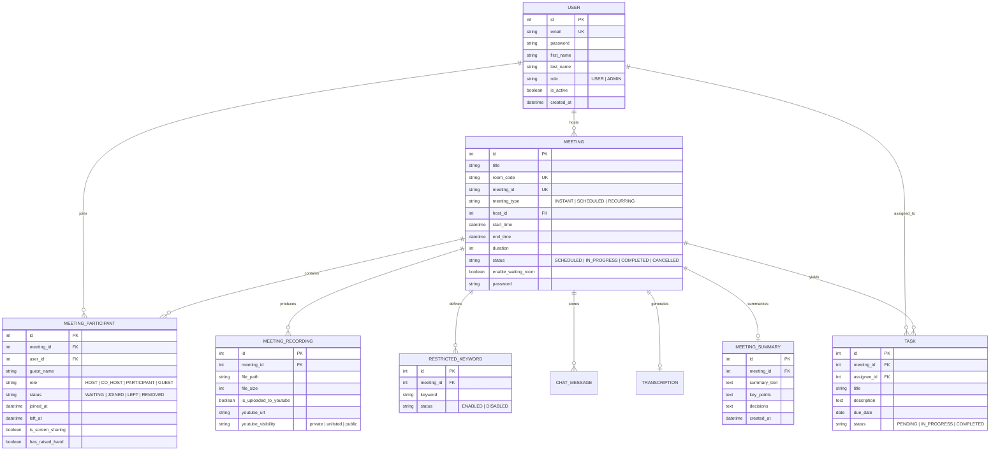

# MeetFlow — Enterprise Real-Time Collaboration & AI Meeting Platform
## Comprehensive Technical Report & Architecture Documentation

---

> **Document Type:** Technical System Architecture & Project Blueprint  
> **Target Audience:** Engineering Leads, System Architects, Technical Stakeholders & Developers  
> **Version:** 1.0.0  
> **Technology Stack:** Python 3.12+, Django 5.x, Django REST Framework, Django Channels 4.x, WebRTC, Redis, Celery, AssemblyAI, OpenAI  

---

## Executive Summary & Vision

**MeetFlow** is a full-stack, enterprise-grade real-time video conferencing, collaboration, and automated meeting intelligence platform. Engineered to eliminate reliance on proprietary third-party video conferencing plugins, MeetFlow runs natively inside modern web browsers using **WebRTC** mesh peer-to-peer streaming and **Django Channels (WebSockets)**.

Beyond real-time audio/video and chat capabilities, MeetFlow features an automated **AI-Driven Meeting Intelligence Engine** that converts meeting audio into text transcripts (AssemblyAI) and generates structured meeting summaries, key decisions, and actionable task items (OpenAI GPT). It also provides video recording management with optional automated publishing to YouTube (YouTube Data API v3), role-based administration, live room moderation (restricted keyword filtering, waiting room access), and an event-driven webhook subsystem.

```
+-----------------------------------------------------------------------------------+
|                                 MEETFLOW PLATFORM                                 |
+--------------------------+--------------------------+-----------------------------+
|  Real-Time Conferencing  |  AI Intelligence Engine  |     Enterprise Engine       |
|  - Multi-party WebRTC    |  - Speech-to-Text        |  - Dual Auth (JWT/OAuth)    |
|  - WebSockets Signaling  |  - Automated Summaries   |  - Moderation & Webhooks    |
|  - In-Meeting Chat       |  - Action Item Extraction|  - Analytics & YouTube Sync |
+--------------------------+--------------------------+-----------------------------+
```

---

## 1. System Architecture Overview

MeetFlow adheres to a **Clean, Layered Micro-Modular Architecture**. The system separates HTTP state management, asynchronous WebSocket event loops, background worker processing, and database storage.

### 1.1 High-Level Architecture Diagram

```mermaid
graph TD
    subgraph Client Layer
        Browser["Web Browser (HTML5/JS/Bootstrap 5)"]
        WebRTC["WebRTC Peer Engine (Audio/Video/Screen)"]
    end

    subgraph Gateway & Server Layer
        Nginx["Nginx Reverse Proxy / Load Balancer"]
        Daphne["Daphne ASGI Server (WebSockets + HTTP)"]
    end

    subgraph Backend Application Layer (Django 5)
        DRF["Django REST Framework APIs"]
        Channels["Django Channels (WS Consumers)"]
        ServiceLayer["Domain Service Layer"]
        RepoLayer["Repository Layer"]
    end

    subgraph Data & Queue Layer
        Postgres[(PostgreSQL / SQLite Database)]
        Redis[(Redis Cache & Channel Layer)]
        CeleryWorker["Celery Async Task Workers"]
    end

    subgraph External Integrations
        AssemblyAI["AssemblyAI API (Speech-to-Text)"]
        OpenAI["OpenAI API (GPT Summaries)"]
        YouTube["YouTube Data API v3"]
        AWS_S3["AWS S3 / Storage"]
    end

    Browser -->|HTTP/REST| Nginx
    Browser -->|WSS WebSockets| Daphne
    WebRTC <-->|P2P Media Streams| WebRTC

    Nginx --> Daphne
    Daphne --> DRF
    Daphne --> Channels

    DRF --> ServiceLayer
    Channels --> Redis
    ServiceLayer --> RepoLayer
    RepoLayer --> Postgres

    ServiceLayer --> CeleryWorker
    CeleryWorker --> Redis
    CeleryWorker --> AssemblyAI
    CeleryWorker --> OpenAI
    CeleryWorker --> YouTube
    CeleryWorker --> AWS_S3
```

### 1.2 Core Design Principles

1. **Separation of Concerns (SoC):** Distinct separation between HTTP API views, WebSocket consumer routines, business logic (Service Layer), and data queries (Repository Layer).
2. **Dual Gateway Engine (WSGI & ASGI):** Standard request-response cycles are handled asynchronously alongside Daphne ASGI running Channels for low-latency WebSockets.
3. **Asynchronous Heavy Processing:** Network-intensive or CPU-heavy operations (AI transcript extraction, audio file encoding, YouTube uploads) are offloaded to **Celery worker nodes** backed by **Redis**.
4. **Zero Vendor Lock-In Video Mesh:** Uses native browser WebRTC (`RTCPeerConnection`, `RTCDataChannel`) with lightweight WebSocket signaling.

---

## 2. Technical Stack & Dependencies

| Layer | Component / Tool | Purpose & Usage |
| :--- | :--- | :--- |
| **Backend Core** | Python 3.12+, Django 5.x | Primary web framework and ORM engine |
| **API Framework** | Django REST Framework (DRF) | RESTful API serialization, endpoints, and throttling |
| **Real-Time Engine** | Django Channels 4.x, Daphne | WebSockets handling for WebRTC signaling and chat |
| **Database** | PostgreSQL / SQLite | Relational database (managed via `dj-database-url`) |
| **Cache & Channels** | Redis | WebSockets Channel Layer memory store & Celery broker |
| **Task Queue** | Celery | Asynchronous background job runner |
| **Authentication** | `djangorestframework-simplejwt`, `django-allauth` | JWT token authentication & Google OAuth2 integration |
| **Frontend** | Vanilla JavaScript (ES6+), Bootstrap 5, Custom CSS | Dynamic UI rendering without heavyweight SPA build tools |
| **Streaming & Media** | HTML5 WebRTC API | Low-latency P2P video, audio, and screen sharing |
| **Speech-to-Text AI** | AssemblyAI Python SDK | Audio recording transcription |
| **NLP & Summarization**| OpenAI GPT API | Automated meeting recap and action item extraction |
| **Video Publishing** | YouTube Data API v3, Google Auth | Automated meeting recording upload to YouTube |
| **Storage / CDN** | `django-storages` (AWS S3 / Local media) | Cloud media storage for recordings and attachments |

---

## 3. Domain Modules & App Architecture

MeetFlow's codebase under `src/apps/` is structured into 13 modular domain applications, each holding strict encapsulation:

```
src/apps/
├── accounts/        # User authentication, Custom User model, JWT, Google OAuth
├── analytics/       # Platform analytics, attendance metrics, meeting stats
├── api_keys/        # Developer API key generation & rate-limiting validation
├── chat/            # WebSocket room chat consumers & chat message persistence
├── dashboard/       # Executive admin dashboard & system monitoring stats
├── meetings/        # Meeting CRUD, WebRTC signaling consumer, room codes, keyword filter
├── notifications/   # Real-time and persistent in-app notifications
├── participants/    # Participant tracking, role management (Host, Co-Host, Attendee)
├── recordings/      # Recording upload handling, storage, YouTube integration
├── summaries/       # AI summary generator using OpenAI GPT models
├── tasks/           # Meeting action items & task assignment engine
├── transcripts/     # Speech-to-text processing pipeline via AssemblyAI
└── webhooks/        # Event subscription & signed HMAC webhook dispatching
```

### Modular Responsibilities Breakdown



---

## 4. Real-Time WebRTC & WebSocket Pipeline

MeetFlow uses a Mesh WebRTC signaling pattern where participants negotiate direct peer connections using standard WebSocket events routed through Django Channels.

### 4.1 WebRTC Peer Connection Negotiation Sequence



### 4.2 In-Meeting Features Managed via WebSockets
- **Media Toggles:** Mute/unmute microphone, enable/disable video stream.
- **Screen Sharing:** Canvas track substitution (`navigator.mediaDevices.getDisplayMedia`).
- **Hand Raising:** Real-time priority queue for host awareness.
- **Waiting Room Admittance:** Host approval workflow before granting room entrance.
- **Restricted Keyword Filtering:** Live text inspection of in-meeting chat against prohibited keywords configured per meeting.

---

## 5. AI Transcription & Summarization Pipeline

One of MeetFlow's flagship capabilities is automated post-meeting intelligence processing.



1. **Audio Extraction:** Recorded meeting media (`.webm`/`.mp4`/`.mp3`) is passed to AssemblyAI.
2. **Transcript Processing:** Speaker diarization maps utterances to distinct participant identities.
3. **GPT Analysis:** Full transcript text is sent to OpenAI with engineered prompts to construct:
   - Concise Executive Summary
   - Key Decisions Made
   - Actionable Items (with auto-assigned team members and due dates)

---

## 6. Database Schema & Data Models (ERD)

The system database structure links users, meeting rooms, participants, recordings, AI outputs, and task items.



---

## 7. API Architecture & Primary Endpoints

MeetFlow exposes REST APIs conforming to standard HTTP status codes, structured JSON responses, and JWT authentication headers (`Authorization: Bearer <token>`).

### 7.1 Key Endpoints Summary

#### Authentication & Profile (`/api/v1/auth/`)
- `POST /api/v1/auth/register/` — Register a new user account.
- `POST /api/v1/auth/token/` — Obtain JWT access & refresh token pair.
- `POST /api/v1/auth/refresh/` — Rotate access token using valid refresh token.
- `GET /api/v1/auth/me/` — Retrieve authenticated user profile.

#### Meeting Management (`/api/v1/meetings/`)
- `GET /api/v1/meetings/` — List user's scheduled/past meetings.
- `POST /api/v1/meetings/` — Schedule or generate an instant meeting room.
- `GET /api/v1/meetings/{id}/` — Retrieve meeting metadata and room configuration.
- `POST /api/v1/meetings/api/join/` — Join room by room code & validate password.

#### Media & Recording Operations (`/api/v1/recordings/`)
- `POST /api/v1/recordings/meetings/{id}/start/` — Start room recording stream.
- `POST /api/v1/recordings/meetings/{id}/stop/` — Finalize and store meeting recording.
- `GET /api/v1/recordings/meetings/{id}/url/` — Fetch local media URL & YouTube upload status.

#### AI Processing (`/api/v1/transcripts/` & `/api/v1/summaries/`)
- `POST /api/v1/transcripts/meetings/{id}/generate/` — Async trigger for AssemblyAI speech recognition.
- `GET /api/v1/transcripts/meetings/{id}/` — Retrieve timestamped utterances transcript.
- `POST /api/v1/summaries/meetings/{id}/generate/` — Async trigger for OpenAI summary extraction.
- `GET /api/v1/summaries/meetings/{id}/` — Fetch key points, decisions, and action items.

#### Platform Analytics (`/api/v1/analytics/`)
- `GET /api/v1/analytics/meetings/` — Aggregated meeting count, duration metrics, and status breakdowns.
- `GET /api/v1/analytics/attendance/` — Average attendance per room and participant role distribution.
- `GET /api/v1/analytics/recordings/` — Storage consumption stats & YouTube export rate.

---

## 8. Installation, Setup & Environment Configuration

### 8.1 Prerequisites
- **Python 3.10+** (Tested on Python 3.12/3.14)
- **Redis Server** (For WebSockets Channel Layer & Celery)
- **Git**

### 8.2 Environment Variables (`.env`)

```ini
# Django Configuration
SECRET_KEY=your-django-secret-key
DEBUG=True
ALLOWED_HOSTS=localhost,127.0.0.1

# Database Configuration (PostgreSQL or SQLite fallback)
DATABASE_URL=sqlite:///src/db.sqlite3

# Redis & Channels Configuration
REDIS_URL=redis://127.0.0.1:6379/0

# AI API Credentials
OPENAI_API_KEY=your-openai-api-key
ASSEMBLYAI_API_KEY=your-assemblyai-api-key

# OAuth & YouTube API Configuration
GOOGLE_CLIENT_ID=your-google-client-id
GOOGLE_CLIENT_SECRET=your-google-client-secret
```

### 8.3 Development Environment Setup Steps

```bash
# 1. Clone repository
git clone https://github.com/RituparnaGit55/meeting-room.git
cd meeting-room

# 2. Create and activate virtual environment
py -m venv venv
# Windows:
venv\Scripts\activate
# Linux/macOS:
source venv/bin/activate

# 3. Install core dependencies
pip install -r requirements.txt

# 4. Run database migrations
py src/manage.py migrate

# 5. Seed test admin user (Default: admin / admin123)
py create_test_user.py

# 6. Start Development Server
py start_server.py
# Server will be accessible at http://127.0.0.1:8000/ or http://127.0.0.1:8001/
```

---

## 9. Deployment Architecture Blueprints

MeetFlow supports two production deployment patterns:

### 9.1 Containerized Production Stack (Docker Compose)

```
                       ┌─────────────────────────┐
                       │     Nginx (Port 80/443) │
                       │    (TLS / SSL Proxy)    │
                       └────────────┬────────────┘
                                    │
             ┌──────────────────────┴──────────────────────┐
             │                                             │
             ▼                                             ▼
┌─────────────────────────┐                   ┌─────────────────────────┐
│  Daphne / Gunicorn ASGI │                   │    Static Files & Media │
│   (App Server Container)│                   │   (AWS S3 / Nginx Volume)│
└────────────┬────────────┘                   └─────────────────────────┘
             │
 ┌───────────┼───────────────────┐
 ▼           ▼                   ▼
┌──────────┐ ┌─────────────────┐ ┌────────────────┐
│PostgreSQL│ │      Redis      │ │ Celery Workers │
│ (DB Container)│ (Cache/Channels)│ (Task Processor)│
└──────────┘ └─────────────────┘ └────────────────┘
```

### 9.2 Serverless Deployment (Vercel Adapter)
MeetFlow includes a Vercel deployment adapter via `api/index.py` and `vercel.json` for lightweight HTTP serverless invocation with external hosted PostgreSQL (Neon / Supabase) and external Upstash Redis.

---

## 10. Security, Verification & Quality Assurance

### 10.1 Security Measures
- **HMAC SHA-256 Signature Verification:** Webhook deliveries carry an `X-MeetFlow-Signature` header computed with a shared secret to prevent spoofing.
- **REST Throttle Protection:** AnonRateThrottle and UserRateThrottle prevent brute-force attacks on login and room join endpoints.
- **Parameterised Queries:** Pure ORM queries protect against SQL injection vulnerabilities.
- **Session & Token Isolation:** Short-lived JWT access tokens (15 mins) paired with rotating refresh tokens (7 days).

### 10.2 Test Suite Execution

```bash
# Run unit & integration test suite
py src/manage.py test

# Verify Webhook delivery & HMAC signatures
py test_webhooks.py

# Run API boundary & payload validation tests
py test_invalid_payloads.py
```

---

## 11. Future Architectural Roadmap

1. **Selective Forwarding Unit (SFU) Migration:** Upgrade from full-mesh P2P WebRTC to an SFU architecture (Mediasoup or Janus) to scale room capacity beyond 20 concurrent active video feeds up to 500+ participants per room.
2. **Real-Time Live Captioning:** Stream live transcript snippets over WebSockets using AssemblyAI Realtime API directly during active video calls.
3. **Calendar Interoperability:** Bi-directional iCal/CalDAV sync with Google Workspace and Microsoft Outlook calendars.

---

*Report prepared by MeetFlow Engineering Team.*  
*Source Code Repository:* [github.com/RituparnaGit55/meeting-room](https://github.com/RituparnaGit55/meeting-room)
